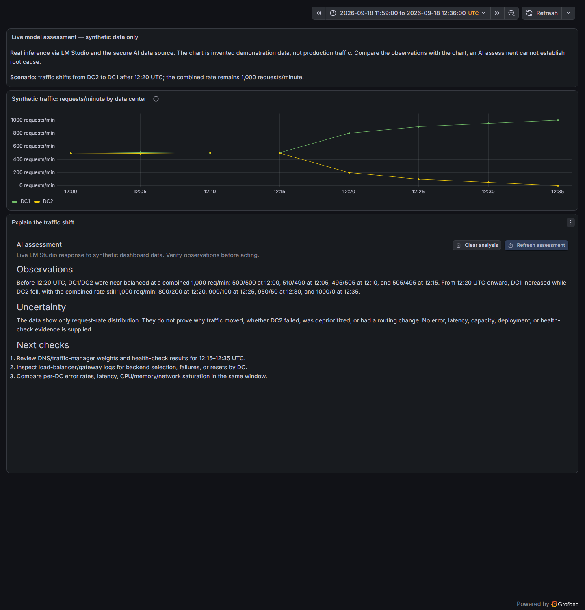
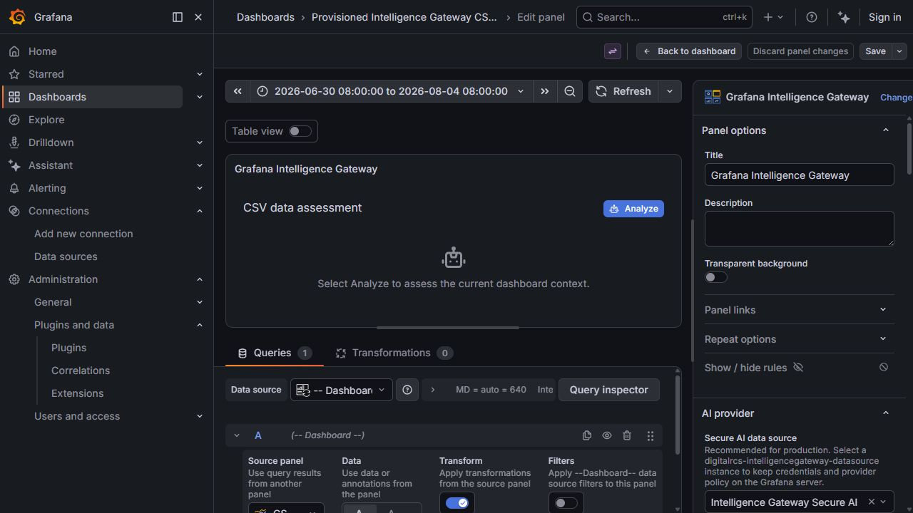

# Intelligence Gateway Secure AI data source

This DigitalRCS backend data-source plugin is the secure provider boundary for the companion
`digitalrcs-intelligencegateway-panel`. Grafana encrypts provider credentials stored in `secureJsonData`; only the Go
backend decrypts and adds them to provider requests. Dashboards and browser code never receive a credential.

Plugin ID: `digitalrcs-intelligencegateway-datasource`  
Grafana: `>=11.6.0`

Read the [catalog overview](src/README.md) for product capabilities, requirements, and the first-panel workflow. The catalog README is maintained in `src/README.md` and packaged as `dist/README.md`; this root README covers implementation and development.

Install this data source **alongside**, not inside, the [Grafana Intelligence Gateway panel](https://github.com/digitalrcs/grafana-intelligence-gateway). Both belong to the same Grafana installation, and the configured instance must be in the dashboard's organization. See [Installation and Quick Start](wiki/Installation-and-Quick-Start.md) for exact directory placement and [catalog integration](docs/CATALOG_INTEGRATION.md) for packaging and dependency details.

> **Demo only: the supplied mock does not run AI.** The provisioned **DEMO ONLY - Mock AI (no inference)** connection returns a fixed delivery receipt. It does not understand data or images. No cloud credentials or hosted AI access are included. A successful mock request proves delivery, not an assessment.

### Two-phase setup

1. **Credential-free connection check:** keep the supplied mock instance and verify its labeled receipt.
2. **Real assessment:** add a **separate** Intelligence Gateway Secure AI instance under **Connections → Data sources**. Supply your reachable provider URL, compatible model, and secure credential if required; select **Save & test**. Select this new instance under the panel's **AI provider → Secure AI data source**, not **Queries**. For images, enable image analysis and approve the actual vision model. Use synthetic input for the first real request.

Provider URLs are resolved by the Grafana server/container, not the browser. For LM Studio on a Docker Desktop host, an example is `http://host.docker.internal:1234/v1`; the server must accept that connection. Use a reachable network address for a remote provider. Enable the HTTP override only on an approved trusted network. See the [complete own-provider checklist](wiki/Installation-and-Quick-Start.md#phase-2-real-assessment-with-your-own-provider).



The [GitHub Wiki](https://github.com/digitalrcs/grafana-intelligence-gateway-datasource/wiki) contains the complete installation, configuration, security, panel-integration, review, and troubleshooting guides.

## What this enables

Operators can use an administrator-configured model to summarize selected dashboard data, draft incident handovers, or suggest verification steps. The companion panel gathers Grafana query results and displays the assessment; this data source provides server-side provider access, credentials, and shared request limits. It can also return an answer DataFrame for a supplied prompt through its query editor. It does not collect metrics independently or establish root cause.

Version 1.1.0 adds a bounded image transport and the Open WebUI, Grafana LLM, and Copilot Studio provider profiles. Use the matching 1.1.0 companion panel for all image controls. See the [1.1.0 release notes](docs/RELEASE_NOTES_1.1.0.md) for upgrade steps and validation boundaries; a prepared build or GitHub release is not Grafana catalog approval.

The companion panel supports three input combinations through the same required secure data source:

| Input           | Panel workflow                                                                                                   | What reaches the provider                                                                         |
| --------------- | ---------------------------------------------------------------------------------------------------------------- | ------------------------------------------------------------------------------------------------- |
| Data only       | Connect **Queries**, attach no images, select **Analyze**.                                                       | Prompt and this panel's serialized query results.                                                 |
| Images only     | Turn off **Include query data with images**, capture or upload images, preview, then select **Analyze images**.  | Prompt, selected images, and non-secret context such as the time range; no serialized query rows. |
| Data and images | Keep **Include query data with images** on, connect **Queries**, preview images, then select **Analyze images**. | Prompt, this panel's query results, and selected images.                                          |

Images can come from the rendered dashboard, selected rendered panels, or PNG/JPEG uploads. Capturing a different panel does **not** retrieve its raw query results. The **Queries** source and **AI provider > Secure AI data source** remain separate connections. Uploaded or captured images always require an explicit send; automatic analysis is text-only.

The credential-free Docker demo uses a **fixed mock receipt, not AI inference**. Follow the [worked traffic-shift example](https://github.com/digitalrcs/grafana-intelligence-gateway/wiki/Reviewer-Walkthrough) for the purpose, synthetic inputs, separate real-provider setup, and captured assessment.

## Configuration contract

Non-secret `jsonData`:

```json
{
  "provider": "openai",
  "baseUrl": "https://api.openai.com/v1",
  "defaultModel": "gpt-4.1-mini",
  "timeoutSeconds": 300,
  "allowedModels": ["gpt-4.1-mini", "gpt-4.1"],
  "maxOutputTokens": 256000,
  "allowInsecureHttp": false,
  "enableVision": false,
  "allowedVisionModels": []
}
```

Write-only `secureJsonData` supports `apiKey`, `bearerToken`, and `directLineSecret`. A bearer token takes precedence over
an API key for ordinary compatible providers. Grafana LLM requires its service-account bearer token; Copilot Studio
requires its separate Direct Line secret. Neither profile falls back to another credential type.
OAuth client-credentials exchange and streaming are not supported. Legacy `clientSecret` and `allowStreaming`
configuration values are ignored; remove unused client secrets through provisioning or Grafana's data-source API.

Provider choices are `openai`, `lmstudio`, `openwebui`, `grafana-llm`, `copilot-studio`, and `custom`. Open WebUI accepts its root or `/api` base URL and uses `/api/models` and `/api/chat/completions`. Grafana LLM requires a base URL ending in `/api/plugins/grafana-llm-app/resources/llm/v1` (a Grafana deployment subpath may precede it), the `base` or `large` model alias, and a Grafana service-account token stored in `secureJsonData.bearerToken`. It runs as that account, not the dashboard viewer. The configured LLM app requires Grafana 13+ and has its own two-minute provider timeout.

The Copilot Studio preview adapter uses a published agent's approved Direct Line channel, with `secureJsonData.directLineSecret` and an HTTPS base URL such as `https://directline.botframework.com/v3/directline`. The European and Indian regional Direct Line hosts are also supported. Model fields are local aliases for the configured agent, not underlying model choices. Direct Line does not apply temperature or output-token controls; the agent owns those policies. A channel secret does not authenticate an end user or bypass an agent's SSO. Interactive sign-in is not implemented and sign-in responses fail explicitly. Responses must correlate to the submitted activity and provide an `acceptingInput`/`expectingInput` hint or `endOfConversation` completion signal; incomplete progress is not shown as a final assessment. **Save & test** exchanges a token to check channel connectivity/credentials without sending an agent message.

Image analysis is disabled by default. Enable `enableVision` and explicitly list image-capable models in `allowedVisionModels`; every entry must also be permitted by `allowedModels` or the default-only policy. The backend never guesses vision support from model names. For Grafana LLM, approve an alias only after verifying that the app's mapped model accepts images. See [configuration](wiki/Configuration.md).

An empty `allowedModels` permits only `defaultModel`. A nonempty list must include the default model. When upgrading
from 1.0.0, explicitly list any additional models your panels use before saving the configuration.

The included provisioning example reads `OPENAI_API_KEY` from the Grafana server/container environment. Never commit a
real key or put one in dashboard JSON.

## Backend API

The panel can access these data-source resources through Grafana's authenticated data-source resource API:

- `GET /models` returns only administrator-permitted model IDs, without provider-specific metadata.
- `GET /capabilities` returns `provider`, `generationControls`, and the effective `vision` policy, permitted image-model IDs, MIME types, and fixed image limits; it never contacts the provider or returns credentials. Copilot Studio sets both generation controls to false.
- `POST /chat/completions` and `POST /analyze` accept a bounded gateway request and return the provider's
  OpenAI-compatible response.

Example request body:

```json
{
  "prompt": {
    "system": "You are a careful observability analyst.",
    "user": "Assess the supplied dashboard data."
  },
  "model": "gpt-4.1-mini",
  "temperature": 0.2,
  "maxOutputTokens": 1200,
  "stream": false
}
```

For Chat Completions providers, the effective output cap is `min(request.maxOutputTokens, jsonData.maxOutputTokens)`. If the request omits a cap, the
administrator ceiling is still sent to the provider. The ordinary data-source query editor exposes the same basic
request and returns a one-row `answer` frame, while the companion panel should use the resource API directly.
Copilot Studio does not expose these generation controls; configure response policy on the published agent instead.

Reasoning models may consume the hard output budget before producing a visible answer. A short-answer instruction is only a soft request, not a separate reserved answer budget. For example, a panel request of 8,192 tokens with an administrator ceiling of 16,384 sends a cap of 8,192; an administrator ceiling of 4,096 reduces it to 4,096. Increase the appropriate limit only within the model's capabilities and organizational policy. Token exhaustion and timeout are different failures: the first of the panel, data-source, proxy, or provider deadlines still ends a slow request. The data-source timeout supports 1–600 seconds.

Image-capable clients can add `"images": [{"name": "Traffic panel", "dataUrl": "data:image/png;base64,..."}]` to the resource request. Supply actual standard base64 PNG/JPEG data, not the illustrative ellipsis. Existing `prompt` and text-only `messages` requests remain supported. Validated attachments become typed `text`/`image_url` parts on the last user message. Arbitrary remote image URLs and client-supplied multimodal message parts are rejected. Capture, preview, and sending are explicit actions in the companion panel; images are not stored in dashboard settings.

## Security policy

- Provider URLs are administrator-controlled and resource paths are fixed; dashboard requests cannot choose a host or
  arbitrary upstream path.
- HTTPS is required by default. An administrator may explicitly enable **Allow insecure HTTP** (`allowInsecureHttp`) for
  organizational networks whose hostnames or addresses cannot be classified reliably. This override permits HTTP
  without hostname locality checks and can expose credentials and prompts in transit; use network controls accordingly.
- OpenAI remains restricted to `api.openai.com` even when the HTTP override is enabled.
- Redirects are rejected. Link-local, multicast, and unspecified destinations are rejected.
- Text-only bodies and the serialized text portion of image requests are capped at 1 MiB. Image requests are capped at 18 MiB encoded JSON, inbound and outbound; provider responses remain capped at 16 MiB.
- Images require explicit administrator approval, strict base64, matching MIME/decoded format, and a complete PNG/JPEG decode. Limits: 8 images, 4 MiB decoded bytes each, 12 MiB decoded bytes total, 4096 pixels per side, 16,000,000 pixels each and 32,000,000 pixels total. Unknown fields and remote URLs are rejected.
- Each data-source instance permits four concurrent calls and 30 calls per minute. Further calls fail immediately with
  HTTP 429 instead of queuing large image bodies; retry after an active request finishes. Provider/model-specific budget and
  organization billing limits should remain enabled as the authoritative cost control.
- Provider response bodies are never included in error messages. Prompts, responses, and credentials are not logged.
- Resource responses are non-cacheable and use JSON with content-type sniffing disabled. Non-JSON or malformed provider
  responses are rejected with a sanitized error.
- Only `system`, `user`, and `assistant` message roles are accepted. The configured model allow-list and token ceiling are
  enforced server-side.

Grafana data-source permissions should restrict who may edit and query this instance. Review egress/firewall rules as a
second SSRF boundary.

## Development

Requirements: Node.js 22+, npm, Go version from `go.mod`, Mage, Docker, and Docker Compose. Grafana's scaffold tooling is
supported on Windows through WSL.

```bash
npm install
npm run typecheck
npm run lint
npm run test:ci
npm run build
mage -v test
mage -v build:linux
npm run package:plugin
docker compose up
```

Use `npm run package:plugin` instead of Windows `Compress-Archive`: it preserves the Linux backend binary's required
`0755` executable mode and the explicit top-level plugin directory in the ZIP. The filename comes from the built
`dist/plugin.json` ID and version; missing required catalog files, referenced images, or backend binaries fail before
an archive is created. Test the helper with `python -B -m unittest discover -s scripts -p test_package_plugin.py`.

Open <http://localhost:3000> and sign in with `admin` / `admin`. The development stack provisions a deterministic mock
provider, the data source, and a review dashboard; it requires no external credential. Use **Save & test**, then open
**Dashboards > Intelligence Gateway Data Source Review** and run the sample query. The health check calls the provider's
`/models` route so it verifies network access without sending a prompt. Copilot Studio instead exchanges and discards a
Direct Line token; it does not start an agent conversation or test inference or end-user authentication.

Restart Grafana after changing `src/plugin.json`. The generated GitHub Actions workflows build the frontend and backend,
run tests, package a ZIP with the required top-level plugin directory, and sign when
`GRAFANA_ACCESS_POLICY_TOKEN` is configured.

If port 3000 is already in use, set `GRAFANA_PORT` before starting Compose (for example, `GRAFANA_PORT=3002`).

## Panel integration

In the companion panel, select this instance under **AI provider > Secure AI data source**. The panel stores this
data-source UID plus non-secret model, temperature, and output choices. **Load models securely** uses the `/models`
resource, and **Analyze** posts the constructed prompt to `/chat/completions`. The current panel uses this server-side
connection with buffered responses; it has no direct provider credential fields. Keep the panel's **Queries** connection
pointed at the data to analyze, and choose this AI connection separately under **AI provider**.



## Integrated Docker test

When both repositories are sibling directories, the panel repository's `docker-compose.yaml` mounts both `dist`
directories and provisions this data source with UID `intelligence-gateway-secure`. Build this frontend and Linux backend,
build the panel, and run `docker compose up --build` from the panel repository. Open <http://localhost:3004> and use
**Intelligence Gateway: traffic-shift walkthrough**. The default mock needs no provider credential and performs no
inference. Follow the [real-provider walkthrough](https://github.com/digitalrcs/grafana-intelligence-gateway/wiki/Reviewer-Walkthrough)
to configure a separate instance for an actual assessment.

## License

Apache-2.0. Copyright 2026 DigitalRCS.
